<div align="center">


# mailroute

**One Resend-compatible API in front of every mail server you own.**
Route each email to your SMTP servers, Resend, SendGrid or Mailgun, fail over when one goes down,
and keep every send in a dashboard your team can actually use.

[](https://laravel.com)
[](https://www.php.net)
[](https://www.postgresql.org)
[](https://livewire.laravel.com)
[](https://tailwindcss.com)
[](#api)

[Features](#features) · [Quick start](#quick-start) · [API](#api) · [Routing](#how-routing-works) · [Deploy](#deploy)

</div>

<picture>
  <source media="(prefers-color-scheme: dark)" srcset="docs/screenshots/overview-dark.png">
  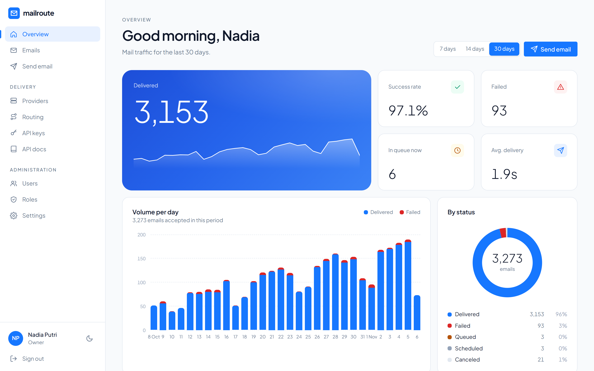
</picture>

## Why

Your app sends password resets, receipts and sign-in codes through one SMTP server. At 2 a.m. it stops answering and every email fails with it. Moving to a single email API swaps one point of failure for another.

mailroute sits in between. Your app talks to **one HTTP endpoint** that speaks Resend's API, and mailroute decides per email which of **your** providers sends it: by sender, recipient domain, tag or API key, by priority or by weight, within each provider's rate limits. When a provider fails, the same email goes out through the next one, and the broken provider is skipped until it recovers.

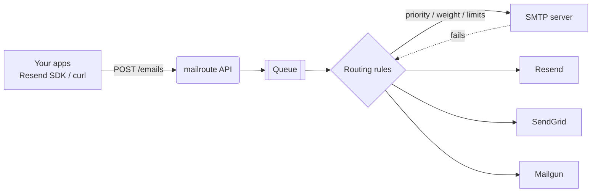

## Features

<table>
<tr>
<td width="50%" valign="top">

**Read any email, see every attempt**
Click a row in the send log to open it: sandboxed HTML preview, plain text, source, attachments, and each delivery attempt with the provider, timing and error. Download it as `.eml`, duplicate it or retry it.

</td>
<td width="50%">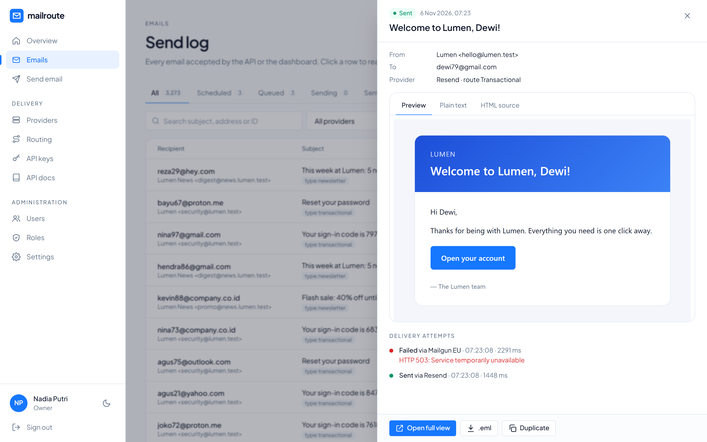</td>
</tr>
<tr>
<td>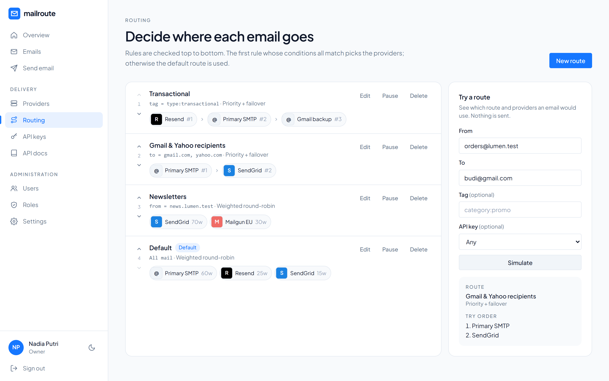</td>
<td valign="top">

**Rules decide who sends**
Match on sender domain, recipient domain (wildcards), tag or API key. Each route fails over by priority or splits traffic by weight. The simulator shows which providers an email would try, in order, before you send anything.

</td>
</tr>
<tr>
<td valign="top">

**Providers that know when they are broken**
SMTP (STARTTLS, SSL or plain), Resend, SendGrid and Mailgun (US/EU). Per-minute, hour and day limits are reserved atomically in Postgres; after repeated failures a provider is skipped for a cooldown, then probed again. Test the connection or send a test email from the dashboard.

</td>
<td>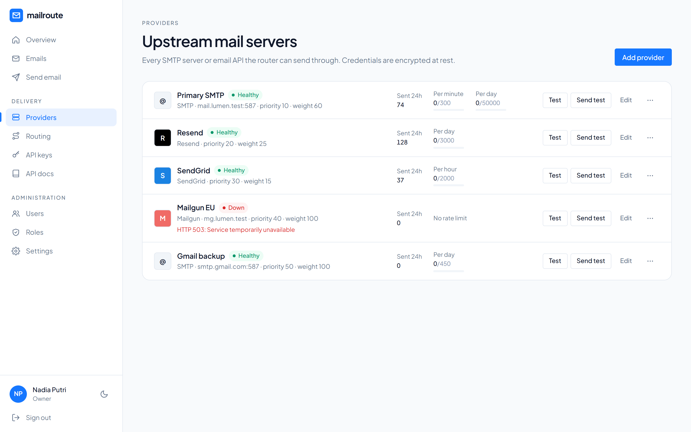</td>
</tr>
<tr>
<td>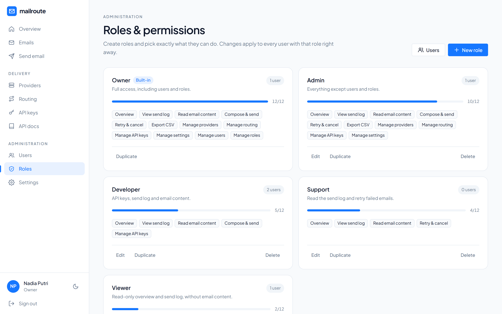</td>
<td valign="top">

**Users and roles you define**
Add teammates and give each a role. Roles are yours to create: tick exactly which of 12 permissions they get, for example a support role that sees the send log and can retry, but cannot read email content. The built-in Owner role always keeps full access.

</td>
</tr>
</table>

<details>
<summary><b>More screens</b>: send log, compose, users, docs, sign-in, dark mode</summary>
<br>

| Send log | Compose |
| --- | --- |
| 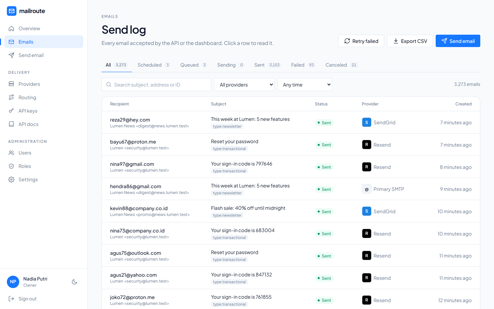 | 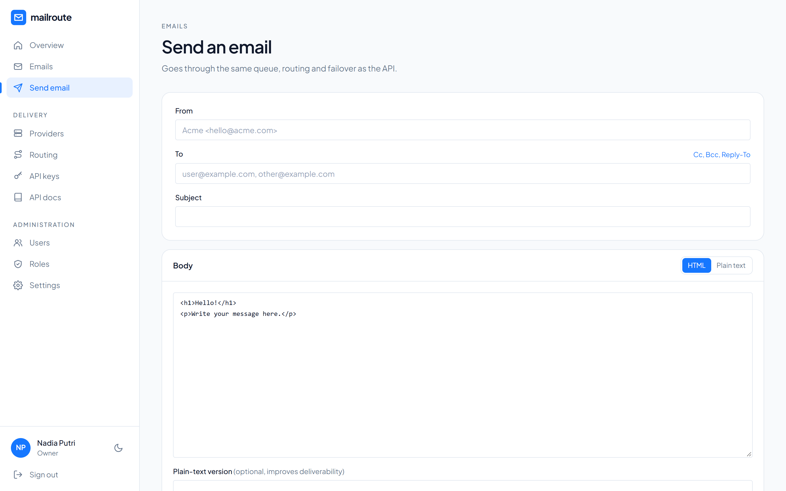 |
| **Users** | **Built-in API docs** |
| 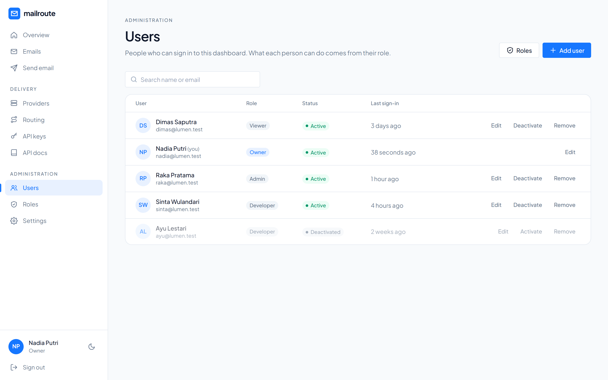 | 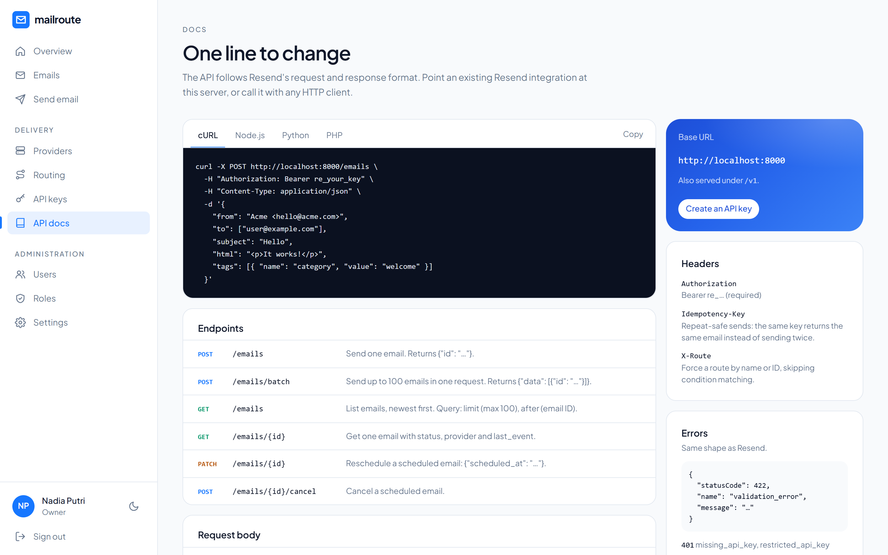 |
| **Sign-in** (optional reCAPTCHA v2 / v3) | **Dark mode** |
| 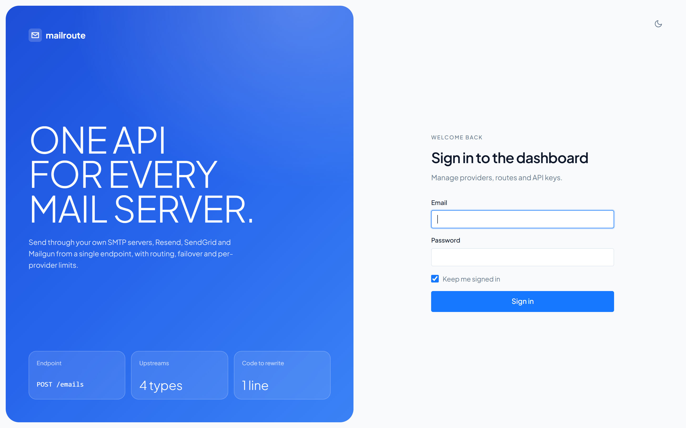 | 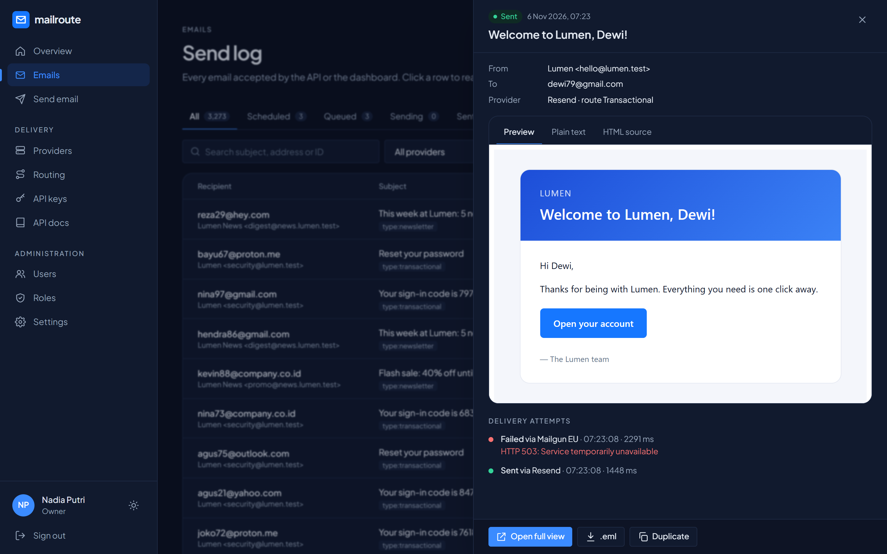 |
| **Providers, dark** | **Routing, dark** |
| 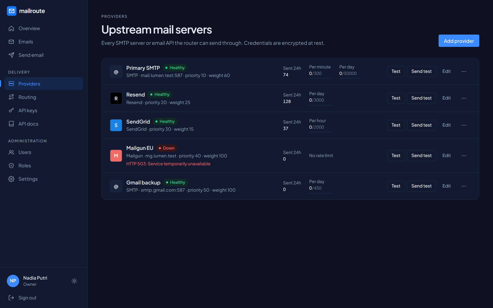 | 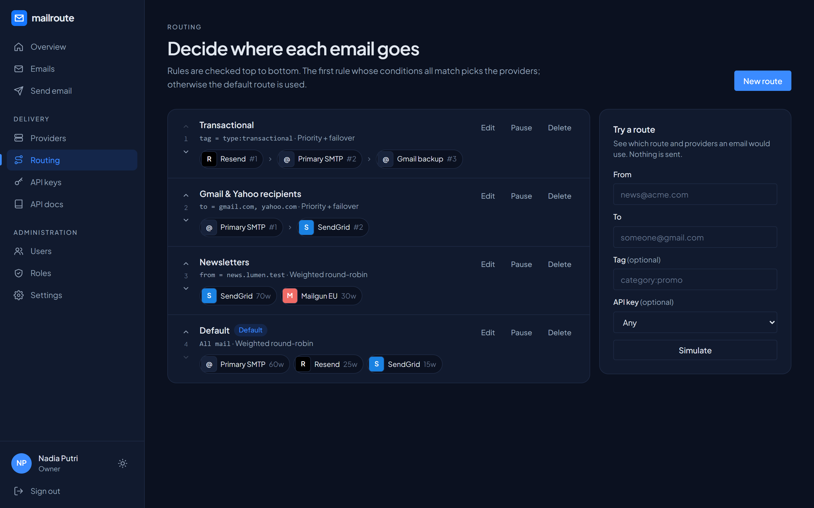 |

</details>

### Everything in the box

- **Resend-compatible API**: `POST /emails`, `POST /emails/batch`, `GET /emails`, `GET /emails/{id}`, `PATCH /emails/{id}`, `POST /emails/{id}/cancel`, same payloads and error format, also under `/v1`. Scheduling (`scheduled_at`, ISO date or "in 1 hour"), `Idempotency-Key`, attachments (base64 or URL, 40 MB), tags and custom headers. `X-Route` forces a route.
- **Smart retries**: connection and auth problems fail over to the next provider at once; rejected recipients (550-553) stop immediately; when every provider fails the email is retried after 1, 5 and 30 minutes.
- **Overview** with animated charts: daily volume for 7/14/30 days, status donut, provider share, top recipient domains, success rate and average delivery time.
- **Send log** with status tabs, search, filters, bulk retry of failed mail and CSV export.
- **Compose** and schedule emails from the browser through the same routing as the API.
- **Users and dynamic roles**, deactivation that signs people out immediately, and protection against removing the last owner.
- **Sign-in protection**: 5 wrong passwords lock an account for 30 minutes (20 per IP), and optional Google reCAPTCHA v2 or v3.
- **Light and dark mode**, sidebar layout that works on phones.
- **No Redis needed**: the queue, cache and rate limiter run on PostgreSQL (`FOR UPDATE SKIP LOCKED`), so it also runs on shared hosting.

## Quick start

Requirements: PHP 8.3+ with `pdo_pgsql`, Composer, Node 20+, PostgreSQL 13+.

```bash
git clone https://github.com/Adytm404/http-email.git mailroute && cd mailroute
composer install
npm install && npm run build
cp .env.example .env
php artisan key:generate
# set APP_URL and the DB_* values in .env (for local development also set APP_ENV=local, APP_DEBUG=true)
php artisan migrate
```

```bash
php artisan serve
```

```bash
php artisan queue:work --queue=emails,default
```

Create the first admin with `php artisan app:create-admin you@example.com`, or open the login page with `?setup=<MAILROUTE_SETUP_TOKEN>` (set a long random token in `.env`; with `APP_ENV=local` a direct visit from the same machine needs no token). Then add a provider, an API key, and send.

Want the dashboard full of data like the screenshots? Seed a separate schema:

```bash
DB_SEARCH_PATH=demo php artisan migrate && DB_SEARCH_PATH=demo php artisan db:seed --class=DemoSeeder
```

<a id="api"></a>

## API

```bash
curl -X POST https://mail.example.com/emails \
  -H "Authorization: Bearer re_your_key" \
  -H "Content-Type: application/json" \
  -d '{"from":"Acme <hello@acme.com>","to":"user@example.com","subject":"Hello","html":"<p>It works</p>"}'
# {"id":"01a1ad3c-7e9b-7f1a-b5c2-4e0d9a6f2c11"}
```

Already on Resend? Keep your code and point the SDK at mailroute:

```bash
RESEND_BASE_URL=https://mail.example.com
```

```js
import { Resend } from 'resend';
const resend = new Resend(process.env.RESEND_API_KEY); // a mailroute key: re_...
await resend.emails.send({ from: 'Acme <hello@acme.com>', to: ['user@example.com'], subject: 'Hello', html: '<p>It works</p>' });
```

Errors use Resend's shape (`{"statusCode":422,"name":"validation_error","message":"…"}`). `GET /emails/{id}` adds `status`, `provider`, `provider_message_id`, `attempts`, `sent_at` and `failed_reason` to Resend's fields. Keys are either full access or sending only.

## How routing works

1. If the request has an `X-Route` header naming an active route, that route is used.
2. Otherwise the first active route, top to bottom, whose conditions all match wins; if none match, the default route is used; with no routes, every active provider is used by priority.
3. Paused providers and providers cooling down after repeated failures are dropped. Failover orders the rest by priority; weighted draws the first by weight and keeps the others as fallbacks.
4. Each candidate must reserve a slot in its minute, hour and day limits (one atomic Postgres upsert), otherwise it is skipped.
5. A provider fault moves the email to the next candidate in the same run; a rejected recipient fails the email; if all candidates fail, the job retries with backoff.

## Deploy

**VPS**: serve `public/` with Nginx + PHP-FPM, run `php artisan config:cache route:cache view:cache`, and keep workers running with systemd or Supervisor:

```ini
# /etc/systemd/system/mailroute-worker@.service  (enable mailroute-worker@1 … @4)
[Service]
User=www-data
WorkingDirectory=/var/www/mailroute
ExecStart=/usr/bin/php artisan queue:work --queue=emails,default --sleep=1 --max-time=3600
Restart=always

[Install]
WantedBy=multi-user.target
```

```cron
* * * * * cd /var/www/mailroute && php artisan schedule:run >> /dev/null 2>&1
```

**Shared hosting (cPanel)**: clone into the subdomain folder, keep `APP_ENV=production` and `APP_DEBUG=false`, set `SESSION_SECURE_COOKIE=true` behind HTTPS, point the document root at `public/` (or rewrite to it with `.htaccess`), set `MAILROUTE_QUEUE_VIA_SCHEDULER=true`, and add the single `schedule:run` cron above. The scheduler then starts a worker every minute that polls the queue for 55 seconds. If outgoing SMTP is redirected to the local mail server, turn off *SMTP Restrictions* in WHM to use external SMTP providers.

## Configuration

| Variable | Default | |
| --- | --- | --- |
| `MAILROUTE_API_RATE_LIMIT` | `600` | API requests per minute per key |
| `MAILROUTE_QUEUE_VIA_SCHEDULER` | `false` | Start the queue worker from cron (shared hosting) |
| `MAILROUTE_SETUP_TOKEN` | | Required as `?setup=` to create the first admin from the login page (any environment, except a direct local visit under `APP_ENV=local`) |
| `MAILROUTE_ALLOW_PRIVATE_ATTACHMENT_URLS` | `false` | Allow `attachments[].path` to fetch private/internal addresses and non-80/443 ports |
| `MAILROUTE_LOGIN_MAX_ATTEMPTS` | `5` | Wrong passwords before an account is locked |
| `MAILROUTE_LOGIN_LOCKOUT_MINUTES` | `30` | Lockout length |
| `MAILROUTE_CAPTCHA_DISABLED` | `false` | Ignore the reCAPTCHA setting (recovery switch) |

Everything else (default sender, retention, failover threshold and cooldown, reCAPTCHA keys) lives on the Settings page. `php artisan app:captcha-off` turns off a misconfigured captcha.

## Development

Tests run against PostgreSQL in a separate `testing` schema (create it once with `CREATE SCHEMA testing;`), with fake drivers instead of real providers:

```bash
php artisan test
```

Stack: Laravel 13, Livewire 4, Tailwind CSS 4, Symfony Mailer, PostgreSQL. The screenshots use the fictional "Lumen" data from `DemoSeeder`.
